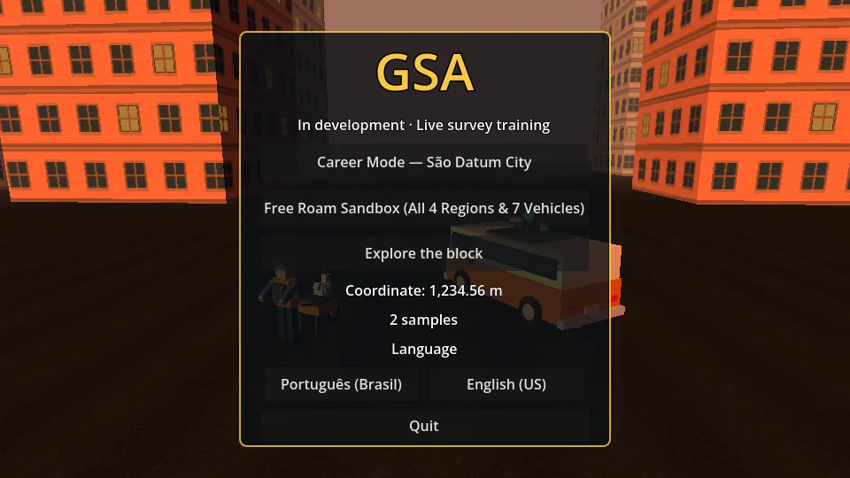
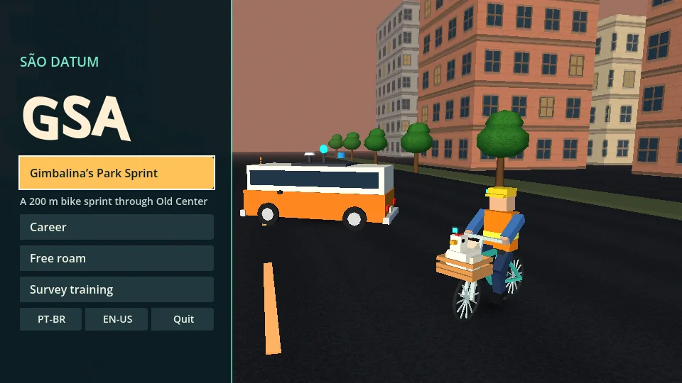
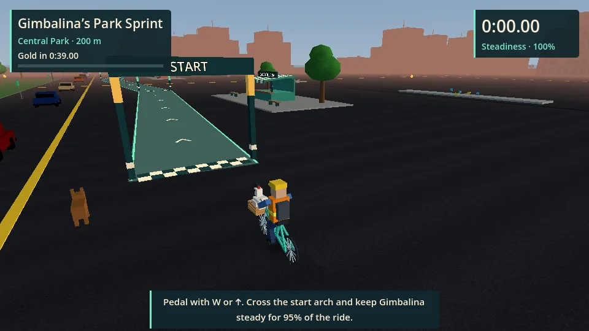
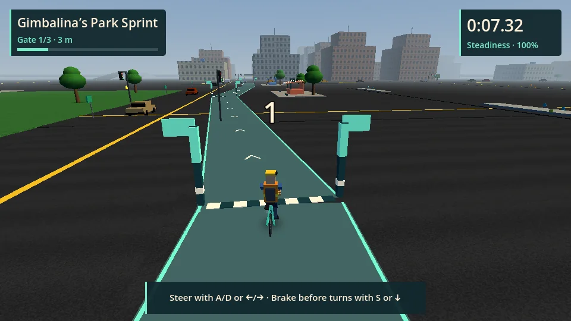
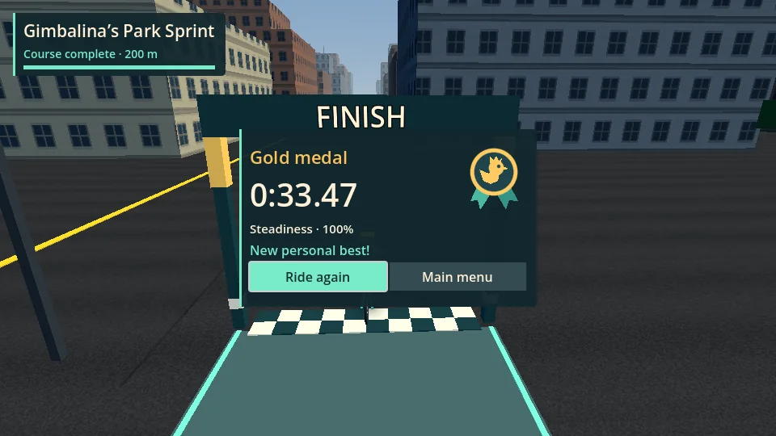

# Desafio da Gimbalina no Parque Central

A prova tem 200 m entre os arcos e três portões intermediários. A largada e a chegada usam o instante em que a bicicleta ou o carrinho cruza a linha. O cronômetro exclui a aproximação. A cada passo de física, a prova registra se a inclinação longitudinal e a lateral da cabeça ficam dentro de ±5°. Para receber medalha, pelo menos 95% das amostras precisam atender aos dois limites.

## Capturas do jogo

| Tela inicial no commit `bc83b0c` | Tela inicial com o desafio |
| --- | --- |
|  |  |

| Largada | Primeiro portão | Chegada |
| --- | --- | --- |
|  |  |  |

As imagens foram capturadas no Godot 4.7.2, em Linux, a 960 × 540 com renderização OpenGL por Mesa llvmpipe. A condução automatizada perdeu o primeiro portão ao seguir em linha reta. Após reiniciar, passou pelos três portões e ganhou ouro em **33,47 s**, com **100%** das amostras dentro do limite. O recorde apareceu ao voltar do menu para outra tentativa.

## Reproduzir

`python3 scripts/verify.py --exports host` executa os testes do domínio, percorre a prova pela cena inicial e repete o percurso no executável exportado. A condução usa os comandos de aceleração e direção do jogador. Para obter também as capturas em Linux, use um diretório vazio para a tentativa e outro para as imagens.

```sh
run_dir=$(mktemp -d)
capture_dir=$(mktemp -d)
GSA_PARK_TEST_DIR="$run_dir" GSA_PARK_CAPTURE_DIR="$capture_dir" \
  ./launch_game.sh --fixed-fps 12 -- --park-run-smoke
```

O teste de domínio cobre o limite exato de 95%, uma tentativa abaixo do limite, os três tempos de medalha, a interpolação de passagem, os atalhos e a perda de Gimbalina. O aceite integral de T-F18-04 inclui também os filtros e a coleção. A avaliação de dificuldade e diversão por jogadores segue aberta.
