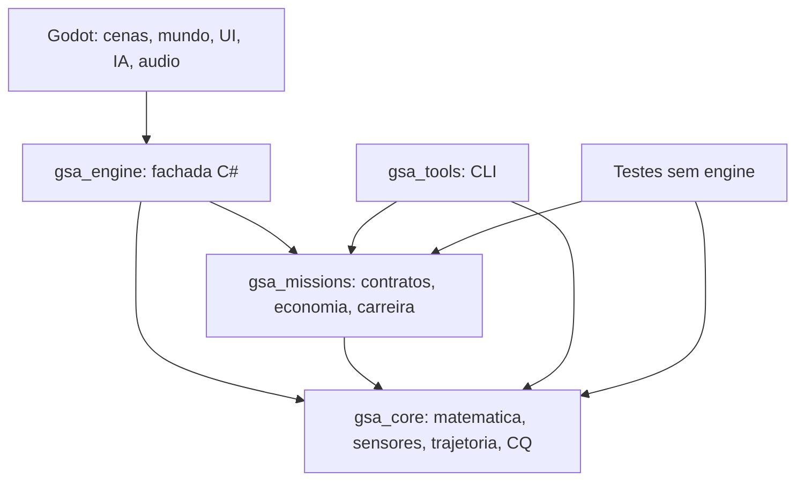
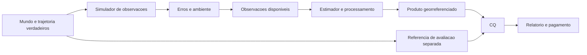

# Arquitetura técnica

## Módulos e dependências

| Componente | Responsabilidade | Dependências permitidas |
| --- | --- | --- |
| `gsa_core` | Matemática double, observações, erros, estimador, georreferenciamento, índices espaciais e CQ | Bibliotecas .NET; nenhuma referência a Godot, interface ou estado global do jogo |
| `gsa_missions` | Dados JSON, máquina de contratos, gerador, livro-caixa, progressão e desbloqueios | Core e serialização .NET; nenhuma cena |
| `gsa_engine` | Converter coordenadas/tipos, capturar física e renderização, gerenciar filas de amostras, armazenamento e fachada para GDScript | Core, Missions, API Godot |
| Projeto Godot | Cenas, controle, tráfego, ambiente, interface, animação, áudio, narrativa | Fachada; não chama Core diretamente via GDScript |
| `gsa_tools` | Validar conteúdo, preparar céu, reproduzir observações e gerar relatórios/exports | Core, Missions e leitores de arquivos neutros |

Diretórios de implementação futura: `src/Gsa.Core`, `src/Gsa.Missions`, `src/Gsa.Engine`, `src/Gsa.Tools`, `game/`, `tests/`, `content/`, `assets/`. São destinos, não componentes já existentes. A solução .NET fica na raiz. Testes do domínio usam xUnit; smoke tests de integração usam cenas Godot executáveis em modo headless quando não dependem de GPU.

## Limites de confiança da simulação

`TruthSample` e `EvaluationReference` pertencem à geração/avaliação e não podem entrar na API do estimador. Os pontos de controle conhecidos são entradas explícitas do jogador; pontos de checagem são reservados ao CQ. IDs semânticos identificam correspondências, mas não autorizam consultar suas coordenadas verdadeiras para corrigir o produto.

Observações brutas são imutáveis. Processamento cria versões derivadas com identificação de parâmetros e entradas; um ajuste não reescreve os brutos. A visualização usa o produto estimado, mantendo o overlay de verdade restrito à bancada/debug.

## Relógios, coordenadas e execução

- Física a 60 Hz; sensores têm agenda própria baseada no relógio físico. A renderização não determina a quantidade de amostras científicas.
- Tempo físico é expresso em segundos; calendário acelerado e prazos são outro relógio. Pausa congela ambos; ver [parâmetros](parametros.md).
- Core usa vetores/quaternions double em ENU. Conversão Godot é centralizada; detalhes em [interfaces](interfaces.md).
- Começar com renderer Compatibility e física Godot padrão. `CharacterBody3D` serve ao controle cinemático de carrinho/bicicleta/motoneta; veículos de quatro rodas usam `RigidBody3D` com suspensão por raios e forças explicitamente implementadas. Trocas de backend requerem medição e ADR, não são pressupostas pelo documento inicial.
- A edição .NET do Godot e o SDK .NET são dependências separadas. M0 fixa versões exatas e templates de exportação após smoke test, conforme a [documentação C#](https://docs.godotengine.org/en/stable/tutorials/scripting/c_sharp/c_sharp_basics.html).

## Concorrência e orçamento

Consultas de colisão/raycast usam a janela segura de física do adaptador; não disparar chamadas ao espaço físico de workers arbitrários. A API documenta essa restrição em [Ray-casting](https://docs.godotengine.org/en/stable/tutorials/physics/ray-casting.html). Workers recebem lotes imutáveis de resultados para ruído, transformações, índices e serialização. A UI e as cenas só são atualizadas na thread da engine.

Uma fila por sensor preserva ordem por tempo, sensor e número de sequência. Backlog máximo de 0,5 s de simulação; excedê-lo suspende a captura daquele sensor e produz evento de saturação. Não fabricar amostras perdidas nem inflar densidade por peso estatístico. Alterar taxa nominal é configuração de perfil divulgada no planejamento.

LOD afeta apenas desenho. Métricas usam amostras de aquisição, não pontos visíveis na GPU. O caminho GPU para LiDAR e GDExtension são alternativas condicionadas ao benchmark de M5; devem reproduzir os mesmos contratos de observação e passar os fixtures de referência.

## Persistência e compatibilidade

Save em diretório de usuário, com manifest versionado, configurações, carreira, livro-caixa, contratos, inventário, veículo, lotes e referências a chunks. Escrita em temporário, checksum e substituição atômica do manifest; manter uma geração anterior recuperável. A associação dos lotes pendentes ao veículo é persistida, mas só o descarregamento os protege da destruição no jogo.

Replay científico grava observações, seeds por subsistema, versão de modelos e eventos; playback visual grava poses e eventos da cena. Entradas e seeds sozinhas não constituem a garantia. Determinismo bit a bit é exigido para a mesma versão/build/runtime do Core; comparação entre plataformas usa tolerâncias numéricas documentadas.

## Fontes e evolução

As versões, preços e comparações Unity/Unreal do original são contexto histórico, não dependências normativas. Não instalar engines alternativas ou adicionar Rust/C++ antecipadamente. Cada dependência externa deve ter versão fixa, finalidade, licença e teste de integração registrados em M0 ou na tarefa que a introduzir.
