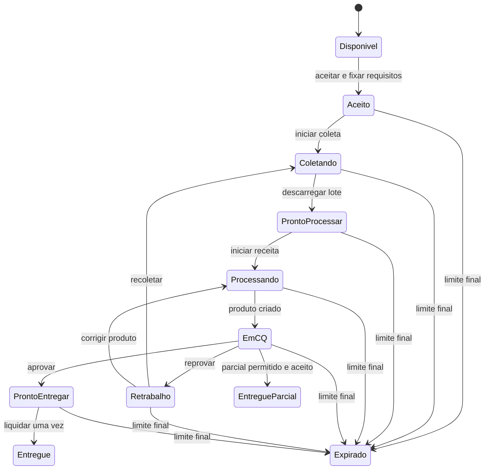

# Interfaces e contratos de dados

Esta é a fronteira normativa entre os subsistemas. Tipos abaixo são contratos lógicos C#; serialização externa usa JSON UTF-8, nomes `snake_case`, números invariantes e `schema_version: 1`. Datas reais de save são UTC ISO 8601; eventos de jogo usam ticks. IDs de conteúdo são strings estáveis; instâncias usam UUID. Enum desconhecido, valores não finitos, referência ausente ou versão futura são rejeitados com diagnóstico de campo. Campos de métricas não aplicáveis são ausentes, nunca zero fictício.

## Convenções geométricas

| Item | Convenção |
| --- | --- |
| Mapa | ENU destro: E leste, N norte, U acima, metros e double |
| Corpo | X frente, Y esquerda, Z acima; atitude `body_to_map` |
| Câmera | X direita, Y abaixo, Z à frente; transformação de montagem explícita |
| LiDAR | X frente, Y esquerda, Z acima |
| Ângulo/tempo | Radianos e segundos internamente; graus apenas na UI |
| Quaternion | `(x,y,z,w)`, normalizado; composições aplicadas da direita para a esquerda |
| Origem fictícia | E0=500000 m, N0=7400000 m, h0=100 m; identificador `SAO_DATUM_LOCAL_V1` |
| Godot | `x=E-E0`, `y=h-h0`, `z=-(N-N0)`; nunca somar a origem grande em float |
| Alturas | `H=h-Ng`; `Ng=10+0.001*(E-E0)+0.0005*(N-N0)` m, modelo didático fictício |
| Tick | Inteiro de 64 bits, 60 ticks por segundo físico; timestamp de amostra aceita frações de tick em segundos |

O datum local não tem código EPSG nem correspondência territorial real. [Exportação](features/F20-exportacao/spec.md) define separadamente um posicionamento sintético WGS84 para GeoJSON.

## API do domínio

| Contrato | Conteúdo mínimo / operação |
| --- | --- |
| `SimulationContext` | `tick`, `physical_time_s`, `calendar_time_s`, `run_seed`, `model_version`; estado RNG explícito por sensor |
| `PoseSample` | Tempo, posição ENU, quaternion, velocidade e validade; não identifica sozinho se é verdadeiro ou estimado |
| `TruthSample` | Pose verdadeira + ambiente local; acessível apenas a simuladores e avaliação |
| `SensorProfile` | ID, tipo, grau, taxa, alcance/resolução, parâmetros de ruído, consumo, custo de armazenamento e requisitos de montagem |
| `MountCalibration` | Sensor/slot, braço de alavanca, boresight, offset de tempo e versão; valores estimados separados dos físicos |
| `ObservationBatch` | ID, sensor, intervalo, sequência e observações; imutável; inclui ausência de sinal/saturação, não substitui por zero |
| `TrajectoryEstimate` | Poses e covariâncias, tipo de solução, cobertura temporal, flags e IDs de observações usadas |
| `CaptureBatch` | ID, contrato, veículo, observações/imagens/pontos, intervalo, estado de custódia, checksums e versão de perfil |
| `ProcessedProduct` | ID/revisão, lotes de origem, receita de processamento, trajetória usada, artefatos e manifesto de privacidade |
| `EvaluationReference` | Correspondências de verdade, superfícies/células exigidas e pontos de checagem; apenas CQ |
| `QualityReport` | Produto/revisão, métricas com unidade/limite/valor/resultado, conformidade, estrelas, falhas e áreas para recoleta |

Operações puras: `Simulate(observableTruth, profile, environment, rng) -> ObservationBatch`; `Estimate(observations, prior, calibration) -> TrajectoryEstimate`; `Georeference(observations, trajectory, calibration) -> ProductGeometry`; `Evaluate(product, requirements, evaluationReference) -> QualityReport`. A implementação pode separar classes por sensor sem mudar as fronteiras de informação.

## Conteúdo e contratos

| Contrato | Campos obrigatórios |
| --- | --- |
| `ContractDefinition` | `id`, `title_key`, `client_id`, `region_id`, `area_id`, `product`, `required_feature_ids`, `requirements`, `required_capabilities`, `risk`, `calm`, `deadline`, `reward`, `partial_policy`, `delivery_format`, `story_prerequisites` |
| `requirements` | Variantes `threshold` (métrica, unidade, direção `min/max`, `limit`, `excellent`) e `predicate` (métrica, `expected` booleano); superfície e tamanho de célula quando espacial |
| `deadline` | Segundos de calendário relativos à aceitação: `due_after_s`, `expires_after_s`; taxa de multa por hora atrasada e teto |
| `reward` | Valor-base inteiro em Coords, XP-base, reputação, recompensa de história; pagamento realizado pelo livro-caixa |
| `partial_policy` | `disabled` ou lista de entregáveis independentes com peso e requisitos; nenhum requisito de privacidade/formato pode ser dispensado |
| `ContractInstance` | UUID, definição/revisão, seed, snapshot das exigências, estado, timestamps, produto entregue e ID de liquidação |
| `MissionDefinition` | ID, ato, objetivos e eventos, pré-condições, variantes Cidade calma, chaves de diálogo e desbloqueios |
| `SemanticObject` | ID estável, classe, material, região, superfície, tags de feição/privacidade e condição dinâmica |
| `WorldCell` | ID, limites, superfície útil, versão do mapa, visibilidade de céu e classe de ambiente |

Produtos internos: `images`, `feature_inventory`, `point_cloud`, `pavement_profile`. Formato de entrega padrão: `gsa_bundle_v1`; exportar para programas externos não é pré-requisito dos contratos da 1.0. Riscos: `easy`, `moderate`, `hard`, `dangerous`.

Campos geométricos de `area_id` e feições são resolvidos no catálogo do mundo pelo validador, não embutidos em cada contrato. Um inventário contém feição, classe, posição estimada, evidência, confiança e estado de revisão.

### Exemplo normativo de serialização

Ver [contrato de fachadas](examples/contract-fachadas.json) e [relatório com proposta de pagamento](examples/report-fachadas.json), explicados em [exemplos](examples/README.md). São fixtures documentais; os catálogos referenciados serão criados em M0–M2. O schema a implementar em T-F06-01 deve aceitar esse formato.

`requirements.kind` é discriminador obrigatório. `threshold` exige `metric`, `unit`, `direction`, `limit` e `excellent`; ambos os números são finitos, com excelência estritamente melhor no sentido informado. `predicate` exige `metric` e `expected: true`; não participa da média de margens. Uma métrica só aparece uma vez por conjunto de requisitos. Privacidade, formato e limite temporal continuam invariantes de entrega mesmo se um template omitir sua declaração repetida.

Para cada resultado quantitativo, `QualityReport.metrics` guarda `metric`, `value`, `unit`, `limit`, `excellent`, `direction` e `status`; para predicados, `metric`, `value` booleano, `expected` e `status`. Status por métrica: `passed`, `failed` ou `insufficient`; dado insuficiente omite `value` e adiciona `reason_key`. Status do relatório: `approved` ou `rework_required`. A expiração pertence ao contrato e bloqueia entrega mesmo com relatório previamente aprovado.

`PaymentQuote` é saída de Missions, separada do relatório científico: instância, revisão do produto, valor-base, fator de qualidade, multa, valor final e moeda. A proposta não altera saldo; só o comando de entrega aceito cria a transação no ledger. Os exemplos ilustram uma proposta, não pagamento efetuado.

`partial_policy` usa `{"mode":"disabled"}` ou `mode: "deliverables"` com lista de `id`, `weight`, `area_id`, `required_feature_ids` e `requirements`. Pesos positivos somam 1 (tolerância 1e-9); um mesmo entregável/feição não pode ser cobrado duas vezes. Cada conjunto é avaliado independentemente, preservando conformidade global. Aceitar parcial é comando explícito; não há liquidação automática por atingir uma fração da coleta.

## Máquina de estados e eventos

O diagrama representa a fase principal. Lotes descarregados podem ser processados enquanto outros aguardam coleta; a primeira versão limita a um contrato ativo e um processamento por vez. Toda transição não terminal também verifica expiração. Abandono é permitido em qualquer estado não terminal e não paga. Destruição/fuga encerra a saída de campo e apaga apenas seus lotes pendentes: o contrato volta a retrabalho se ainda houver prazo, preservando lotes descarregados. Este comportamento substitui a falha total incondicional do original.

Eventos de domínio têm `event_id`, `instance_id`, `tick`, `kind`, `payload_version`. Comandos relevantes: aceitar, iniciar/parar captura, descarregar, processar, avaliar, entregar, abandonar. Retornos distinguem `accepted`, `invalid_state`, `missing_input`, `expired`, `insufficient_funds`, `storage_full`, `corrupt_data`. Entrega usa uma chave de idempotência derivada da instância; repetir o comando retorna a liquidação existente.

## Fachada Godot

GDScript usa métodos C# da fachada com IDs, escalares, `Dictionary`, `Array` e tipos Godot. O adaptador faz validação/conversão para DTOs do domínio. Não expor coleções mutáveis do Core. Eventos publicados: estado do contrato, status de sensor, lote protegido, processamento concluído, relatório disponível, dinheiro/XP e erro recuperável. Atualizações de HUD são agregadas a 10 Hz; física/amostragem mantêm seus relógios.

## Save e replay

`SaveManifest`: versão do save, versão do conteúdo/modelos, geração, checksum, relógios, seeds/RNG, configuração, carreiras/ledger, contratos, veículo/montagem, lotes, chunks, receitas e referências. `ReplayManifest`: mesmas versões, tick inicial/final, observações brutas, poses visuais, eventos, seeds e catálogo de hashes. Nenhum formato incorpora dependências de cenas serializadas como estado autoritativo do domínio.

Leitor aceita a versão atual e migra a imediatamente anterior em cópia; original permanece intacto. Versão futura ou checksum inválido oferece recuperar geração anterior; nunca sobrescreve automaticamente o único arquivo. Conteúdo removido deve manter alias/migração para IDs salvos. Alterações de fórmula invalidam caches derivados, mas preservam brutos.
