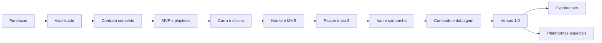

# Roadmap por dependências e gates

[Índice](README.md) · [Funcionalidades](features/README.md) · [Validação](validacao.md)

Não há datas comprometidas sem equipe/disponibilidade. Cada gate exige todas as tarefas atribuídas ao marco, seus critérios locais e os cenários integrados aplicáveis ao escopo entregue. Um cenário de funcionalidade futura não bloqueia uma tarefa anterior de schema ou biblioteca: usar fixture isolado e registrar a integração pendente no marco responsável. O marco seguinte começa após o gate anterior; E1 e E2 partem de M9 e são independentes entre si. Planejar ativos/roteiro já previstos em M4 não antecipa a integração de M8.

Os gates M2/M3 verificam diversão/aprendizado antes de investir no restante da cidade. Protótipo LiDAR de M1 é técnico e não amplia o MVP. Tarefas de bancada de túnel/viaduto são validadas em M5; sua integração narrativa no ato 2 fecha em M6. A disponibilidade de uma funcionalidade não significa que todo o conteúdo de campanha correspondente já foi produzido.

## Lista executável

### M0 — Fundação

**Gate de saída:** Projetos, ferramentas, schemas e localização disponíveis. Consultar o protocolo em [validação](validacao.md).

| Tarefa | Incremento | Documento |
| --- | --- | --- |
| T-F01-01 | Fixar ferramentas e bootstrap | [Tarefas F01](features/F01-fundacao/tasks.md) |
| T-F01-02 | Criar módulos e testes mínimos | [Tarefas F01](features/F01-fundacao/tasks.md) |
| T-F01-03 | Implementar validação de conteúdo | [Tarefas F01](features/F01-fundacao/tasks.md) |
| T-F01-04 | Automatizar builds e exports | [Tarefas F01](features/F01-fundacao/tasks.md) |
| T-F06-01 | Definir e validar dados de contrato | [Tarefas F06](features/F06-contratos-cq/tasks.md) |
| T-F11-01 | Criar localização e glossário inicial | [Tarefas F11](features/F11-interface-localizacao/tasks.md) |

### M1 — Viabilidade técnica

**Gate de saída:** Bancada, orçamento de raios, 50 carros e relatório de hardware. Consultar o protocolo em [validação](validacao.md).

| Tarefa | Incremento | Documento |
| --- | --- | --- |
| T-F02-01 | Criar graybox semântico e coordenadas | [Tarefas F02](features/F02-mundo/tasks.md) |
| T-F02-02 | Pré-calcular visibilidade de céu | [Tarefas F02](features/F02-mundo/tasks.md) |
| T-F03-01 | Implementar locomoção inicial e entradas | [Tarefas F03](features/F03-mobilidade/tasks.md) |
| T-F03-02 | Integrar galinha e estresse | [Tarefas F03](features/F03-mobilidade/tasks.md) |
| T-F04-01 | Implementar projeção e fixtures | [Tarefas F04](features/F04-cameras/tasks.md) |
| T-F04-02 | Integrar observações e miniaturas | [Tarefas F04](features/F04-cameras/tasks.md) |
| T-F05-01 | Implementar observações GNSS e heading | [Tarefas F05](features/F05-gnss/tasks.md) |
| T-F09-01 | Implementar tráfego regular de bancada | [Tarefas F09](features/F09-trafego-clima/tasks.md) |
| T-F15-01 | Construir bancada LiDAR | [Tarefas F15](features/F15-lidar/tasks.md) |
| T-F17-01 | Produzir kit piloto e pipeline de importação | [Tarefas F17](features/F17-arte-audio/tasks.md) |
| T-F19-01 | Instrumentar e medir protótipo | [Tarefas F19](features/F19-validacao-lancamento/tasks.md) |

### M2 — Primeira experiência

**Gate de saída:** Um contrato completo e playtest do loop aceito. Consultar o protocolo em [validação](validacao.md).

| Tarefa | Incremento | Documento |
| --- | --- | --- |
| T-F04-03 | Implementar scheduler e inventário | [Tarefas F04](features/F04-cameras/tasks.md) |
| T-F05-02 | Integrar céu e estado de solução | [Tarefas F05](features/F05-gnss/tasks.md) |
| T-F06-02 | Implementar máquina de contratos | [Tarefas F06](features/F06-contratos-cq/tasks.md) |
| T-F06-03 | Implementar CQ de fotos e inventário | [Tarefas F06](features/F06-contratos-cq/tasks.md) |
| T-F06-04 | Implementar estrelas e valor de entrega | [Tarefas F06](features/F06-contratos-cq/tasks.md) |
| T-F06-05 | Integrar retrabalho e liquidação idempotente | [Tarefas F06](features/F06-contratos-cq/tasks.md) |
| T-F07-01 | Criar processamento básico por receita | [Tarefas F07](features/F07-escritorio/tasks.md) |
| T-F07-04 | Implementar máscaras e conformidade | [Tarefas F07](features/F07-escritorio/tasks.md) |
| T-F08-01 | Implementar ledger e pagamentos | [Tarefas F08](features/F08-economia/tasks.md) |
| T-F10-01 | Criar tutorial e catálogo inicial de história | [Tarefas F10](features/F10-missoes/tasks.md) |
| T-F11-02 | Implementar HUD, mapa e ajustes | [Tarefas F11](features/F11-interface-localizacao/tasks.md) |
| T-F11-03 | Criar quadro, escritório e relatório | [Tarefas F11](features/F11-interface-localizacao/tasks.md) |
| T-F12-01 | Implementar lotes e descarregamento atômico | [Tarefas F12](features/F12-persistencia/tasks.md) |
| T-F12-02 | Implementar save e recuperação | [Tarefas F12](features/F12-persistencia/tasks.md) |
| T-F19-02 | Validar primeira experiência completa | [Tarefas F19](features/F19-validacao-lancamento/tasks.md) |

### M3 — MVP

**Gate de saída:** Níveis 0–2, cinco templates, três missões e gate dos dois públicos. Consultar o protocolo em [validação](validacao.md).

| Tarefa | Incremento | Documento |
| --- | --- | --- |
| T-F02-03 | Montar Centro Velho do MVP | [Tarefas F02](features/F02-mundo/tasks.md) |
| T-F03-03 | Adicionar bicicleta e recursos | [Tarefas F03](features/F03-mobilidade/tasks.md) |
| T-F03-04 | Adicionar motoneta e recuperação | [Tarefas F03](features/F03-mobilidade/tasks.md) |
| T-F04-04 | Adicionar ambiente e sobreposição | [Tarefas F04](features/F04-cameras/tasks.md) |
| T-F04-05 | Integrar capacete e câmeras frente/trás | [Tarefas F04](features/F04-cameras/tasks.md) |
| T-F05-03 | Adicionar aluguel e DGNSS | [Tarefas F05](features/F05-gnss/tasks.md) |
| T-F07-02 | Integrar Arcade e Técnico simplificados | [Tarefas F07](features/F07-escritorio/tasks.md) |
| T-F08-02 | Adicionar loja e progressão inicial | [Tarefas F08](features/F08-economia/tasks.md) |
| T-F09-02 | Implementar calendário, clima e aderência | [Tarefas F09](features/F09-trafego-clima/tasks.md) |
| T-F09-03 | Adicionar bêbados, blitz e cães | [Tarefas F09](features/F09-trafego-clima/tasks.md) |
| T-F09-04 | Implementar contratos tranquilos e Cidade calma | [Tarefas F09](features/F09-trafego-clima/tasks.md) |
| T-F10-02 | Completar MVP e gerador de cinco templates | [Tarefas F10](features/F10-missoes/tasks.md) |
| T-F11-04 | Entregar Geopédia e revisão do MVP | [Tarefas F11](features/F11-interface-localizacao/tasks.md) |
| T-F12-03 | Implementar replay e ferramenta de relatório | [Tarefas F12](features/F12-persistencia/tasks.md) |
| T-F18-01 | Adicionar ovos, marcos e cartas | [Tarefas F18](features/F18-atividades/tasks.md) |
| T-F19-03 | Validar MVP com os dois públicos | [Tarefas F19](features/F19-validacao-lancamento/tasks.md) |

### M4 — Plataforma automotiva

**Gate de saída:** Carro, 360°, rack/oficina, RTK/MEMS, facções iniciais e roteiro completo. Consultar o protocolo em [validação](validacao.md).

| Tarefa | Incremento | Documento |
| --- | --- | --- |
| T-F02-04 | Expandir Centro, Porto e Orla | [Tarefas F02](features/F02-mundo/tasks.md) |
| T-F03-05 | Implementar carro com suspensão | [Tarefas F03](features/F03-mobilidade/tasks.md) |
| T-F04-06 | Adicionar câmera 360° | [Tarefas F04](features/F04-cameras/tasks.md) |
| T-F05-04 | Adicionar RTK e instalação de base | [Tarefas F05](features/F05-gnss/tasks.md) |
| T-F08-03 | Implementar habilidades e reputação completa | [Tarefas F08](features/F08-economia/tasks.md) |
| T-F08-04 | Integrar serviços, seguro e frota avançada | [Tarefas F08](features/F08-economia/tasks.md) |
| T-F09-05 | Integrar perigos e contramedidas urbanas | [Tarefas F09](features/F09-trafego-clima/tasks.md) |
| T-F10-03 | Concluir ato 1 e escrever campanha restante | [Tarefas F10](features/F10-missoes/tasks.md) |
| T-F10-06 | Estabilizar roteiros para gravação | [Tarefas F10](features/F10-missoes/tasks.md) |
| T-F13-01 | Implementar rack e revisões de montagem | [Tarefas F13](features/F13-calibracao/tasks.md) |
| T-F13-02 | Integrar descalibração por impacto | [Tarefas F13](features/F13-calibracao/tasks.md) |
| T-F13-03 | Criar minigames e solvers | [Tarefas F13](features/F13-calibracao/tasks.md) |
| T-F14-01 | Implementar IMU e atitude | [Tarefas F14](features/F14-fusao/tasks.md) |
| T-F16-01 | Criar territórios e identidades fictícias | [Tarefas F16](features/F16-faccoes/tasks.md) |
| T-F16-02 | Implementar atenção e ameaças iniciais | [Tarefas F16](features/F16-faccoes/tasks.md) |
| T-F18-02 | Adicionar álbum e cosméticos | [Tarefas F18](features/F18-atividades/tasks.md) |

### M5 — Levantamento avançado

**Gate de saída:** Kombi, LiDAR, DMI/ZUPT, PPK, CQ avançado e proteção de dados. Consultar o protocolo em [validação](validacao.md).

| Tarefa | Incremento | Documento |
| --- | --- | --- |
| T-F03-06 | Adicionar Kombi | [Tarefas F03](features/F03-mobilidade/tasks.md) |
| T-F06-06 | Adicionar CQ de nuvem e pavimento | [Tarefas F06](features/F06-contratos-cq/tasks.md) |
| T-F07-03 | Integrar processamento avançado | [Tarefas F07](features/F07-escritorio/tasks.md) |
| T-F07-05 | Consolidar jobs e caches | [Tarefas F07](features/F07-escritorio/tasks.md) |
| T-F13-04 | Integrar oficina às passadas LiDAR | [Tarefas F13](features/F13-calibracao/tasks.md) |
| T-F14-02 | Implementar DMI e ZUPT | [Tarefas F14](features/F14-fusao/tasks.md) |
| T-F14-03 | Integrar filtro de trajetória | [Tarefas F14](features/F14-fusao/tasks.md) |
| T-F14-04 | Adicionar PPK, controles e heading duplo | [Tarefas F14](features/F14-fusao/tasks.md) |
| T-F15-02 | Integrar perfilador e georreferenciamento | [Tarefas F15](features/F15-lidar/tasks.md) |
| T-F15-03 | Implementar octree, chunks e LOD | [Tarefas F15](features/F15-lidar/tasks.md) |
| T-F16-03 | Adicionar sabotagem avançada e contramedidas | [Tarefas F16](features/F16-faccoes/tasks.md) |

### M6 — Terrenos e ato 2

**Gate de saída:** Picape, Serra, multirretorno, eventos e ato 2 concluível. Consultar o protocolo em [validação](validacao.md).

| Tarefa | Incremento | Documento |
| --- | --- | --- |
| T-F02-05 | Produzir Serra e terrenos especiais | [Tarefas F02](features/F02-mundo/tasks.md) |
| T-F03-07 | Adicionar picape 4x4 | [Tarefas F03](features/F03-mobilidade/tasks.md) |
| T-F10-04 | Implementar ato 2 e templates avançados | [Tarefas F10](features/F10-missoes/tasks.md) |
| T-F15-04 | Adicionar sensores pareados e múltiplos retornos | [Tarefas F15](features/F15-lidar/tasks.md) |
| T-F18-03 | Adicionar eventos absurdos | [Tarefas F18](features/F18-atividades/tasks.md) |

### M7 — Campanha completa

**Gate de saída:** Van, quatro regiões, ato 3, Geopédia avançada e benchmark. Consultar o protocolo em [validação](validacao.md).

| Tarefa | Incremento | Documento |
| --- | --- | --- |
| T-F02-06 | Integrar cidade e rede de marcos | [Tarefas F02](features/F02-mundo/tasks.md) |
| T-F03-08 | Adicionar van MMS | [Tarefas F03](features/F03-mobilidade/tasks.md) |
| T-F04-07 | Implementar produto de pavimento | [Tarefas F04](features/F04-cameras/tasks.md) |
| T-F10-05 | Implementar ato 3 e levantamento final | [Tarefas F10](features/F10-missoes/tasks.md) |
| T-F11-05 | Completar UI técnica e Geopédia avançada | [Tarefas F11](features/F11-interface-localizacao/tasks.md) |
| T-F12-04 | Adicionar migração e compatibilidade | [Tarefas F12](features/F12-persistencia/tasks.md) |
| T-F15-05 | Entregar perfil de engenharia e otimizar aquisição | [Tarefas F15](features/F15-lidar/tasks.md) |
| T-F16-04 | Integrar facções à cidade completa | [Tarefas F16](features/F16-faccoes/tasks.md) |
| T-F17-02 | Produzir arte da cidade e frota completas | [Tarefas F17](features/F17-arte-audio/tasks.md) |
| T-F19-04 | Otimizar e medir cidade completa | [Tarefas F19](features/F19-validacao-lancamento/tasks.md) |

### M8 — Conteúdo final

**Gate de saída:** Dublagem, rádios, cutscenes, atividades e revisão bilíngue. Consultar o protocolo em [validação](validacao.md).

| Tarefa | Incremento | Documento |
| --- | --- | --- |
| T-F11-06 | Revisar localização e acessibilidade final | [Tarefas F11](features/F11-interface-localizacao/tasks.md) |
| T-F17-03 | Produzir e integrar dublagem bilíngue | [Tarefas F17](features/F17-arte-audio/tasks.md) |
| T-F17-04 | Produzir rádios, trilha e mixagem | [Tarefas F17](features/F17-arte-audio/tasks.md) |
| T-F17-05 | Integrar cutscenes e apresentação final | [Tarefas F17](features/F17-arte-audio/tasks.md) |
| T-F18-04 | Entregar desafio, filtros e coleção completa | [Tarefas F18](features/F18-atividades/tasks.md) |

### M9 — Versão 1.0

**Gate de saída:** RC validado e pacote de publicação com decisões externas resolvidas. Consultar o protocolo em [validação](validacao.md).

| Tarefa | Incremento | Documento |
| --- | --- | --- |
| T-F19-05 | Produzir e validar release candidate | [Tarefas F19](features/F19-validacao-lancamento/tasks.md) |
| T-F19-06 | Preparar distribuição e resolver gates externos | [Tarefas F19](features/F19-validacao-lancamento/tasks.md) |

### E1 — Exportações

**Gate de saída:** LAS/LAZ, CSV e GeoJSON verificados em leitores externos. Consultar o protocolo em [validação](validacao.md).

| Tarefa | Incremento | Documento |
| --- | --- | --- |
| T-F20-01 | Definir adaptadores e dependências de exportação | [Tarefas F20](features/F20-exportacao/tasks.md) |
| T-F20-02 | Implementar LAS e LAZ | [Tarefas F20](features/F20-exportacao/tasks.md) |
| T-F20-03 | Implementar CSV e GeoJSON sintético | [Tarefas F20](features/F20-exportacao/tasks.md) |
| T-F20-04 | Validar exportação em ferramentas externas | [Tarefas F20](features/F20-exportacao/tasks.md) |

### E2 — Plataformas especiais

**Gate de saída:** Mochila, rodoferroviário e barco com missões e produção completa. Consultar o protocolo em [validação](validacao.md).

| Tarefa | Incremento | Documento |
| --- | --- | --- |
| T-F21-01 | Implementar mochila e levantamento interior | [Tarefas F21](features/F21-plataformas-especiais/tasks.md) |
| T-F21-02 | Implementar veículo rodoferroviário | [Tarefas F21](features/F21-plataformas-especiais/tasks.md) |
| T-F21-03 | Implementar barco e margens | [Tarefas F21](features/F21-plataformas-especiais/tasks.md) |
| T-F21-04 | Entregar missões e produção da expansão | [Tarefas F21](features/F21-plataformas-especiais/tasks.md) |

## Passagem de marco

Responsável técnico consolida testes/performance; direção de produto revisa jogabilidade; revisão técnica pedagógica verifica modelos e explicações; produção revisa arte/idiomas/voz. Uma pessoa pode exercer mais de um papel, mas deve registrar qual aceite realizou. Gate falho gera tarefa de correção ligada ao requisito e nova evidência; não marcar automaticamente aceito.

M9 separa pacote tecnicamente validado de publicação efetiva. EXT-02/03/04/05/06 afetam o pacote público; EXT-07 afeta aceite de desempenho. Exportações/plataformas especiais podem ser desenvolvidas localmente a partir do RC tecnicamente aceito enquanto publicação externa aguarda autorização, desde que o gate técnico de M9 esteja registrado; isso não autoriza distribuí-las.
